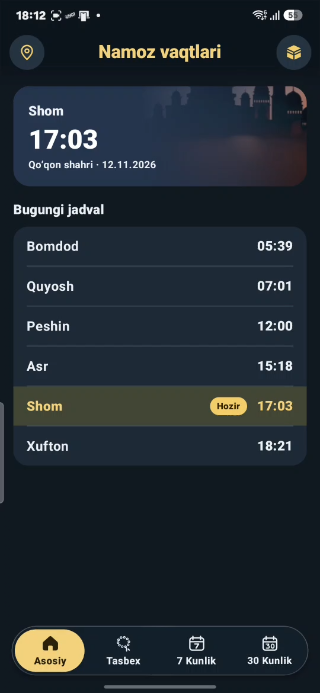
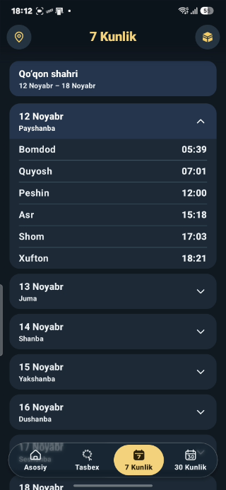
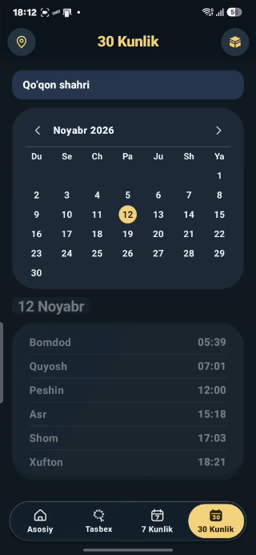
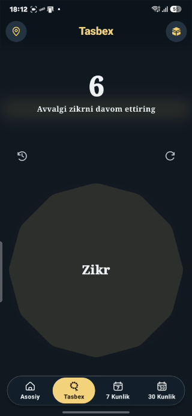

# Muslim App

Muslim App — O‘zbekiston hududlari uchun namoz vaqtlari, Qibla kompasi va tasbehni jamlagan o‘zbek tilidagi Android ilova. Ilova Kotlin va Jetpack Compose bilan yozilgan.

## Asosiy funksiyalar

- **Namoz vaqtlari.** Kunlik, 7 kunlik va oylik jadvallar. Asosiy ekranda joriy namoz vaqti ajralib turadi. Oylik kalendarda istalgan sanani tanlash mumkin.
- **Hudud tanlash.** 223 ta shahar, tuman va viloyat orasidan qidiring, filtrlang yoki telefon joylashuvi orqali mos hududni tanlang.
- **Internetsiz ko‘rish.** Avval yuklangan jadvallar telefonda saqlanadi va ilova qayta ochilganda ham ko‘rinadi. Internet bo‘lganda jadvalni yuqoridan pastga tortib yangilang.
- **Qibla kompasi.** Telefon joylashuvi va kompas sensori yordamida Ka’ba yo‘nalishini ko‘rsatadi.
- **Tasbeh.** Zikr hisoblagichi qiymatini saqlaydi va keyingi safar davom ettirishga imkon beradi.
- **Oq va qora tema.** Ilova telefonning tema sozlamasiga moslashadi.

## Ekran rasmlari

| Asosiy | 7 kunlik |
| :---: | :---: |
|  |  |
| **30 kunlik** | **Tasbeh** |
|  |  |

## Android Studio’da ishga tushirish

**Talablar** — Android Gradle Plugin 9.4.1 bilan mos Android Studio, Android SDK Platform 37 va Android 7.0 (API 24) yoki undan yuqori telefon yoki emulyator. Gradle versiyasi loyihadagi Wrapper orqali olinadi.

1. Android Studio’da **Get from VCS** orqali repozitoriyani klonlang. Terminal orqali klonlash ham mumkin.

   ```bash
   git clone https://github.com/JurabekPM/Muslim_App.git
   cd Muslim_App
   ```

2. Android Studio’da loyihaning asosiy papkasini oching. **SDK Manager** orqali Android SDK Platform 37 ni o‘rnating. **Gradle JDK** uchun Android Studio bilan kelgan **Embedded JDK** ni tanlang va **Sync Project with Gradle Files** ni bajaring.
3. Qurilma ro‘yxatidan telefon yoki emulyatorni, ishga tushirish konfiguratsiyasidan **app** modulini tanlang. **Run ▶** ni bosing. Birinchi sinxronlash va namoz jadvallarini birinchi yuklash uchun internet kerak.
4. **Hozirgi joylashuvim** yoki **Qibla** funksiyasini ishlatganda Android so‘ragan joylashuv ruxsatini bering. Hududni ro‘yxatdan qo‘lda ham tanlash mumkin.

Unit testlarni Windows’da `.gradlew.bat :app:testDebugUnitTest`, macOS va Linux’da `./gradlew :app:testDebugUnitTest` bilan ishga tushiring.

Namoz vaqtlari [Namoz vaqti API](https://namoz-vaqti.uz/?format=docs&lang=lotin&region=toshkent-shahri) orqali olinadi.
